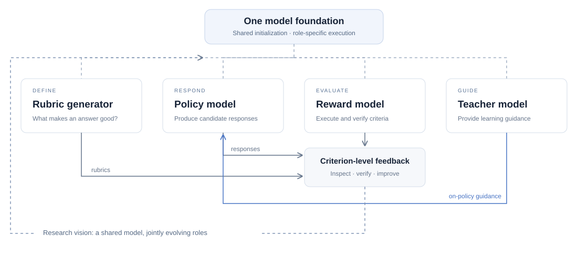

# Rubric-Based Post-Training

Instance-specific criteria connecting evaluation, preference construction, and reinforcement learning.

**[Project Page](https://yuyq96.github.io/rubrics/)** — Explore our research.

[](https://yuyq96.github.io/rubrics/)

## Learning through rubrics

A rubric makes the meaning of a good response explicit for each image–instruction pair. It decomposes quality into concrete, weighted criteria: **essential** criteria capture what the answer must get right, while **additional** criteria describe useful supporting information and reasoning. References ground each criterion in observable facts or verifiable targets.

This structured feedback connects evaluation with learning. **rDPO** uses rubric judgments to select preference pairs, prioritizing essential correctness before finer quality differences. **RLR³** brings criterion-level feedback into online reinforcement learning, combining deterministic verification, minimal-exposure judging, and essential-aware reward aggregation.

Together, these studies explore a shared model foundation for generating criteria, producing responses, and evaluating them. Rubrics provide an inspectable interface through which these roles can support one another.

### Papers

| Paper | PDF |
|---|---|
| Reinforcement Learning with Robust Rubric Rewards (RLR³) | [Read](docs/papers/rlr3.pdf) |
| Visual Preference Optimization with Rubric Rewards (rDPO) | [Read](docs/papers/rdpo.pdf) |

## Citation

```bibtex
@inproceedings{yu2026rdpo,
  title = {Visual Preference Optimization with Rubric Rewards},
  author = {Ya-Qi Yu and Fangyu Hong and Xiangyang Qu and Hao Wang and Gaojie Wu and Qiaoyu Luo and Nuo Xu and Huixin Wang and Wuheng Xu and Yongxin Liao and Zihao Chen and Haonan Li and Ziming Li and Dezhi Peng and Minghui Liao and Jihao Wu and Haoyu Ren and Dandan Tu},
  year = {2026},
  booktitle = {Proceedings of the 2026 Conference on Empirical Methods in Natural Language Processing}
}

@inproceedings{yu2026rlr3,
  title = {Reinforcement Learning with Robust Rubric Rewards},
  author = {Ya-Qi Yu and Hao Wang and Fangyu Hong and Xiangyang Qu and Gaojie Wu and Qiaoyu Luo and Nuo Xu and Huixin Wang and Wuheng Xu and Yongxin Liao and Zihao Chen and Haonan Li and Ziming Li and Dezhi Peng and Minghui Liao and Jihao Wu and Haoyu Ren and Dandan Tu},
  year = {2026},
  booktitle = {Proceedings of the 2026 Conference on Empirical Methods in Natural Language Processing}
}
```
